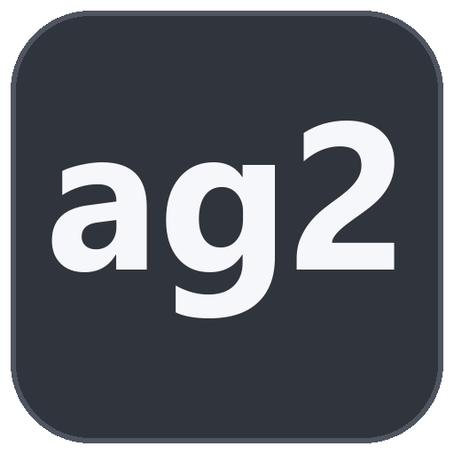
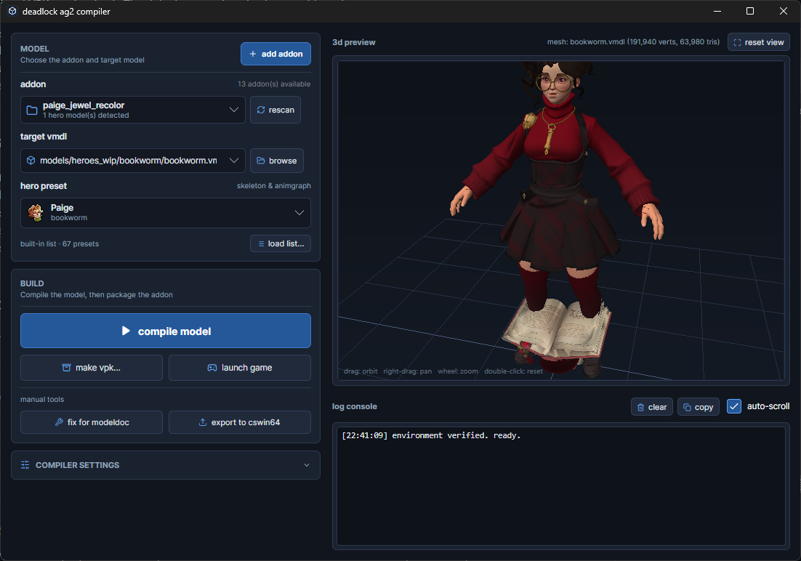

# Deadlock VMDL Compiler

<p align="center">
  
</p>

<p align="center">
  
</p>

Compiles Deadlock hero and NPC models (`.vmdl`) with their AnimGraph 2 skeleton and graphs, which CSDK12 can't do on its own. It can also export a hero from the game into a ready-to-edit CSDK12 addon and fix older models after game updates.

## Quick start

1. Download `DeadlockVmdlCompiler.exe` from [Releases](https://github.com/kwlnd/deadlock-vmdl-compiler/releases) and run it.
2. In **compiler settings**, set:
   - **cswin64 installation**: the folder that contains `game/bin/win64/resourcecompiler.exe`;
   - **csdk addons folder**: your `content/citadel_addons`.
3. Pick an addon and a `.vmdl` (or drop one on the window), check the hero preset, and press **compile model**.
4. Press **make vpk...** to pack the addon, then **launch game** to test it.

The app finds Deadlock through Steam by itself and checks GitHub for updates on start.

## What the buttons do

| Button | What it does |
| --- | --- |
| **add addon** | Exports a hero or neutral from the game (model, animations, materials, cloth) into a new CSDK12 addon. |
| **compile model** | Adds the AG2 skeleton and graphs, compiles with CSWin64, checks the result and copies it into the addon. Your source `.vmdl` stays unchanged. |
| **make vpk...** | Packs the compiled addon into a `.vpk` after checking that the AG2 references are in place. |
| **launch game** | Starts Deadlock with the addon loaded. |
| **sync from game...** | Updates an older `.vmdl` from the installed game (see below). |
| **fix for modeldoc** | Removes AG2 nodes from a decompiled `.vmdl` so ModelDoc can open it. |
| **export to cswin64** | Copies the prepared model to the CSWin64 workspace for manual work. |

## Fixing cameras after the October 2026 update

The October 2026 update changed how hero cameras are attached, so older skins get misplaced cameras. **sync from game...** fixes the source `.vmdl`:

- moves the camera attachments to the new format, keeping your own offsets;
- adds attachments your model is missing (`healthbar`, `hero_attach_*`, ...);
- updates the camera, unit status and hero settings from the game.

It can run on one model or on every model in all addons, and backs up each file first. The app also warns you when you select or compile an outdated model.

## Custom presets

Hero presets tell the compiler which skeleton and graphs to use. **load list...** loads your own list in the same format as [`hero_paths.json`](hero_paths.json):

```json
{
  "my_mushroom": {
    "skel": "models/npc_units/neutral_mushroom_small_01/neutral_mushroom_small_01.vnmskel",
    "graph": "",
    "ui_graph": "",
    "named_graphs": {
      "Neutrals": "animgraphs/animgraph2/npc_units/neutrals/npc_neutral.vnmgraph+mushroom_small.vnmgraph"
    }
  }
}
```

Settings are stored in `%LocalAppData%/DeadlockVmdlCompiler`.

## Building from source

Requires the .NET 10 SDK on Windows x64.

```bash
git clone https://github.com/kwlnd/deadlock-vmdl-compiler.git
cd deadlock-vmdl-compiler
PowerShell -NoProfile -ExecutionPolicy Bypass -File .\publish.ps1
dotnet run --project tests/RegressionChecks/RegressionChecks.csproj -c Release
```

`publish.ps1` builds a single self-contained `.exe` in `publish/`. The bundled ValveResourceFormat package is described in [`third_party/README.md`](third_party/README.md).

## Credits

- **Qusai** ([@Qusai0](https://github.com/Qusai0)) from the Deadlock Modding Discord server: the original idea, and co-maintainer with commit access who builds features and publishes releases (auto-update, NPC presets, animation detection).
- Model and resource parsing by [ValveResourceFormat (Source 2 Viewer)](https://github.com/ValveResourceFormat/ValveResourceFormat).

MIT License.

> [!WARNING]
> This project was developed with AI assistance for the Deadlock modding community.
